# Documentación de Diagramas UML - AgroCloud

Este documento recopila la especificación arquitectónica y de diseño integral del sistema **AgroCloud** mediante diagramas UML y de ingeniería de software basados estrictamente en el código fuente existente en el backend (Spring Boot 3 / Java 17 / JPA / PostgreSQL), el frontend (React 19 / TypeScript / Vite / TailwindCSS) y la infraestructura de despliegue en contenedores Docker. Cubre exhaustivamente todos los tipos de usuarios (`CLIENTE`, `ADMINISTRADOR`, `SOPORTE`, y visitante no autenticado en la `LANDING`).

---

## Índice de Diagramas

- [1. Diagramas de Clases](#1-diagramas-de-clases)
  - [1. Diagrama de clases - Autenticación y Usuarios (backend - security/entity)](#1-diagrama-de-clases---autenticación-y-usuarios-backend---securityentity)
  - [2. Diagrama de clases - Instancias de Base de Datos y Métricas (backend - instance)](#2-diagrama-de-clases---instancias-de-base-de-datos-y-métricas-backend---instance)
  - [3. Diagrama de clases - Planes y Suscripciones (backend - plan / subscription)](#3-diagrama-de-clases---planes-y-suscripciones-backend---plan--subscription)
  - [4. Diagrama de clases - Pagos y Facturación (backend - payment)](#4-diagrama-de-clases---pagos-y-facturación-backend---payment)
  - [5. Diagrama de clases - Incidencias y Soporte Técnico (backend - incident)](#5-diagrama-de-clases---incidencias-y-soporte-técnico-backend---incident)
  - [6. Diagrama de clases - Plantillas de Cultivo y Notificaciones (backend - template / notification)](#6-diagrama-de-clases---plantillas-de-cultivo-y-notificaciones-backend---template--notification)
  - [7. Diagrama de clases - Modelos de Datos y Clientes API (frontend - types / api)](#7-diagrama-de-clases---modelos-de-datos-y-clientes-api-frontend---types--api)
  - [8. Diagrama de clases - Arquitectura de Paneles y Componentes UI (frontend - features)](#8-diagrama-de-clases---arquitectura-de-paneles-y-componentes-ui-frontend---features)
- [2. Diagramas de Actividad](#2-diagramas-de-actividad)
  - [9. Diagrama de actividad - Registro y Creación de Cuenta (Auth)](#9-diagrama-de-actividad---registro-y-creación-de-cuenta-auth)
  - [10. Diagrama de actividad - Aprovisionamiento de Nueva Instancia (Instance)](#10-diagrama-de-actividad---aprovisionamiento-de-nueva-instancia-instance)
  - [11. Diagrama de actividad - Gestión del Ciclo de Vida de Incidencias (Incident)](#11-diagrama-de-actividad---gestión-del-ciclo-de-vida-de-incidencias-incident)
  - [12. Diagrama de actividad - Procesamiento de Pago y Facturación (Payment)](#12-diagrama-de-actividad---procesamiento-de-pago-y-facturación-payment)
  - [13. Diagrama de actividad - Administración de Usuarios y Asignación de Roles (AdminUser)](#13-diagrama-de-actividad---administración-de-usuarios-y-asignación-de-roles-adminuser)
- [3. Diagramas de Casos de Uso](#3-diagramas-de-casos-de-uso)
  - [14. Diagrama de casos de uso - Visitante No Autenticado (landing / auth)](#14-diagrama-de-casos-de-uso---visitante-no-autenticado-landing--auth)
  - [15. Diagrama de casos de uso - Cliente Agrícola (client)](#15-diagrama-de-casos-de-uso---cliente-agrícola-client)
  - [16. Diagrama de casos de uso - Administrador del Sistema (admin)](#16-diagrama-de-casos-de-uso---administrador-del-sistema-admin)
  - [17. Diagrama de casos de uso - Agente de Soporte Técnico (support)](#17-diagrama-de-casos-de-uso---agente-de-soporte-técnico-support)
- [4. Diagramas de Secuencia](#4-diagramas-de-secuencia)
  - [18. Diagrama de secuencia - Autenticación y Obtención de Token JWT (Auth)](#18-diagrama-de-secuencia---autenticación-y-obtención-de-token-jwt-auth)
  - [19. Diagrama de secuencia - Creación y Aprovisionamiento de Instancia con Clave Cifrada (Instance)](#19-diagrama-de-secuencia---creación-y-aprovisionamiento-de-instancia-con-clave-cifrada-instance)
  - [20. Diagrama de secuencia - Apertura e Interacción en Incidencia de Soporte (Incident)](#20-diagrama-de-secuencia---apertura-e-interacción-en-incidencia-de-soporte-incident)
  - [21. Diagrama de secuencia - Consulta de Métricas y Telemetría en Tiempo Real (Monitoring)](#21-diagrama-de-secuencia---consulta-de-métricas-y-telemetría-en-tiempo-real-monitoring)
  - [22. Diagrama de secuencia - Alta y Modificación Administrativa de Usuarios (AdminUsers)](#22-diagrama-de-secuencia---alta-y-modificación-administrativa-de-usuarios-adminusers)
- [5. Diagramas de Estados](#5-diagramas-de-estados)
  - [23. Diagrama de estados - Instancia de Base de Datos (InstanceEntity)](#23-diagrama-de-estados---instancia-de-base-de-datos-instanceentity)
  - [24. Diagrama de estados - Suscripción de Servicio (SubscriptionEntity)](#24-diagrama-de-estados---suscripción-de-servicio-subscriptionentity)
  - [25. Diagrama de estados - Incidencia de Soporte (IncidentEntity)](#25-diagrama-de-estados---incidencia-de-soporte-incidententity)
  - [26. Diagrama de estados - Transacción de Pago (PaymentEntity)](#26-diagrama-de-estados---transacción-de-pago-paymententity)
- [6. Diagrama de Componentes](#6-diagrama-de-componentes)
  - [27. Diagrama de componentes - Arquitectura Global del Sistema (Architecture)](#27-diagrama-de-componentes---arquitectura-global-del-sistema-architecture)
- [7. Diagrama de Despliegue](#7-diagrama-de-despliegue)
  - [28. Diagrama de despliegue - Infraestructura de Producción y Contenedores (Deployment)](#28-diagrama-de-despliegue---infraestructura-de-producción-y-contenedores-deployment)
- [8. Diagrama de Paquetes](#8-diagrama-de-paquetes)
  - [29. Diagrama de paquetes - Estructura Modular Backend Spring Boot (Packages)](#29-diagrama-de-paquetes---estructura-modular-backend-spring-boot-packages)
- [9. Diagrama Entidad-Relación](#9-diagrama-entidad-relación)
  - [30. Diagrama entidad-relación - Base de Datos Relacional PostgreSQL (ERD)](#30-diagrama-entidad-relación---base-de-datos-relacional-postgresql-erd)
- [Notas](#notas)

---

## 1. Diagramas de Clases

### 1. Diagrama de clases - Autenticación y Usuarios (backend - security/entity)

**¿Para qué es?**
Representa la jerarquía y estructura de clases encargada de la identidad, control de roles (`ADMINISTRADOR`, `CLIENTE`, `SOPORTE`), estados de cuenta y seguridad basada en tokens JWT. Es utilizado por desarrolladores y evaluadores para comprender el modelo de autenticación y autorización del backend.

**Código Mermaid**
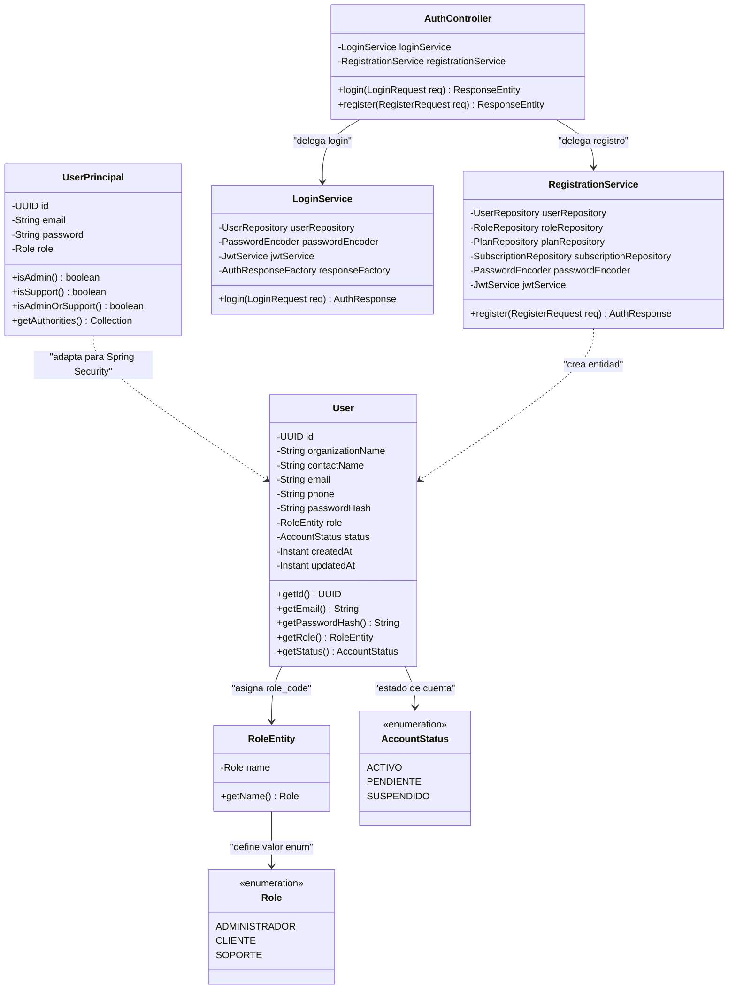

**[Imagen 1]**
> Espacio para pegar la imagen del diagrama aquí.

---

### 2. Diagrama de clases - Instancias de Base de Datos y Métricas (backend - instance)

**¿Para qué es?**
Detalla las entidades, servicios y controladores responsables del aprovisionamiento, consulta de credenciales cifradas y monitoreo de recursos de las bases de datos PostgreSQL para los clientes. Cubre el núcleo funcional del producto para el equipo de desarrollo e infraestructura.

**Código Mermaid**
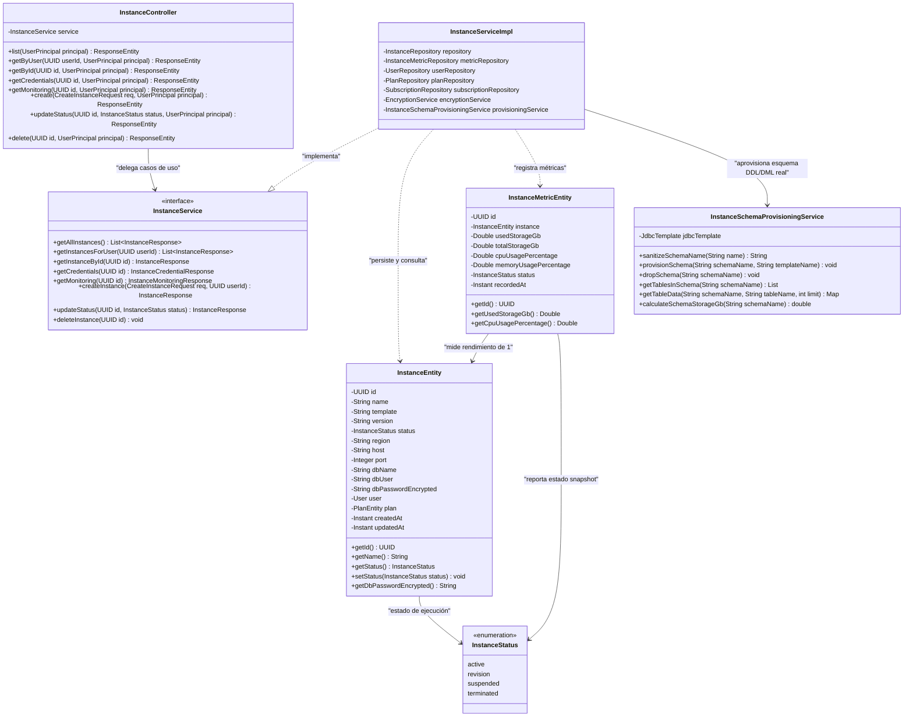

**[Imagen 2]**
> Espacio para pegar la imagen del diagrama aquí.

---

### 3. Diagrama de clases - Planes y Suscripciones (backend - plan / subscription)

**¿Para qué es?**
Modela los planes de servicio ofrecidos por la plataforma, sus límites operativos (almacenamiento, cuota de instancias) y la relación con las suscripciones periódicas de los usuarios. Es fundamental para auditorías comerciales y la lógica de facturación recurrente.

**Código Mermaid**
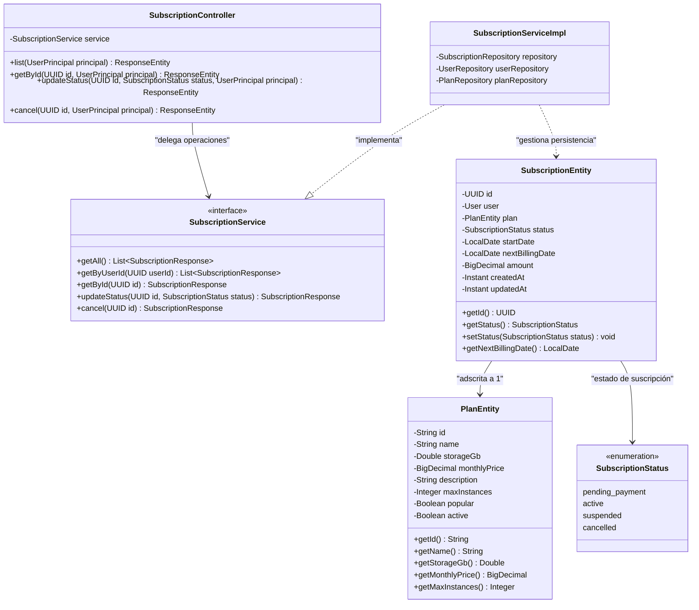

**[Imagen 3]**
> Espacio para pegar la imagen del diagrama aquí.

---

### 4. Diagrama de clases - Pagos y Facturación (backend - payment)

**¿Para qué es?**
Ilustra el módulo transaccional de pagos y emisión de facturas contables asociadas a las suscripciones activas de la plataforma. Ayuda a documentar la trazabilidad financiera y auditoría fiscal del sistema.

**Código Mermaid**
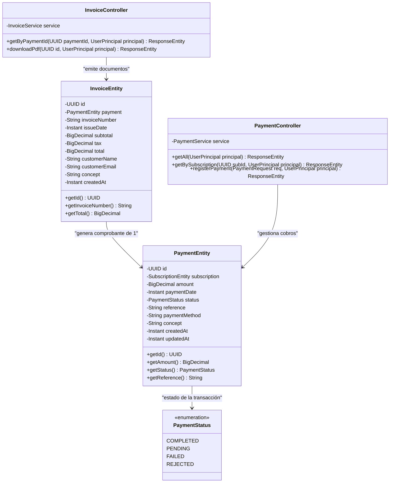

**[Imagen 4]**
> Espacio para pegar la imagen del diagrama aquí.

---

### 5. Diagrama de clases - Incidencias y Soporte Técnico (backend - incident)

**¿Para qué es?**
Representa el sistema de tickets de soporte técnico, diagnósticos guiados y el hilo de comentarios bidireccionales entre el agricultor y los agentes de soporte. Facilita la comprensión del flujo de atención al cliente e inspección de errores en instancias.

**Código Mermaid**
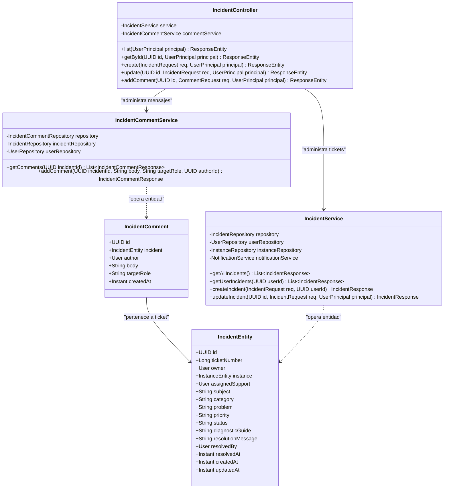

**[Imagen 5]**
> Espacio para pegar la imagen del diagrama aquí.

---

### 6. Diagrama de clases - Plantillas de Cultivo y Notificaciones (backend - template / notification)

**¿Para qué es?**
Muestra el catálogo de esquemas preconfigurados de bases de datos para cultivos (e.g., Maíz, Café, Hortalizas) y el mecanismo reactivo de notificaciones push/SSE para alertas del sistema. Sirve a los equipos de frontend y backend para coordinar flujos asíncronos y aprovisionamientos asistidos.

**Código Mermaid**
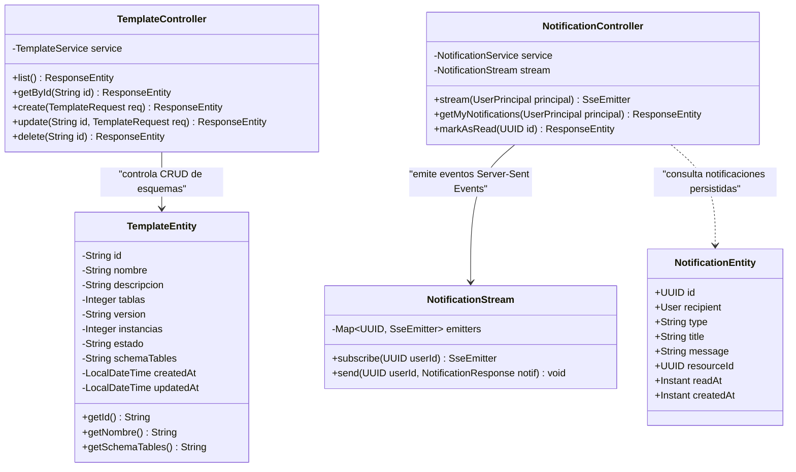

**[Imagen 6]**
> Espacio para pegar la imagen del diagrama aquí.

---

### 7. Diagrama de clases - Modelos de Datos y Clientes API (frontend - types / api)

**¿Para qué es?**
Muestra el modelado estricto de tipos de TypeScript en el Frontend (`User`, `DbInstance`, `Subscription`, `IncidentRecord`, `Plan`) y su vinculación con los clientes HTTP de Axios (`instancesApi`, `incidentsApi`, `subscriptionsApi`, `authApi`). Esencial para el equipo de desarrollo frontend y revisiones de contratos de interfaz.

**Código Mermaid**
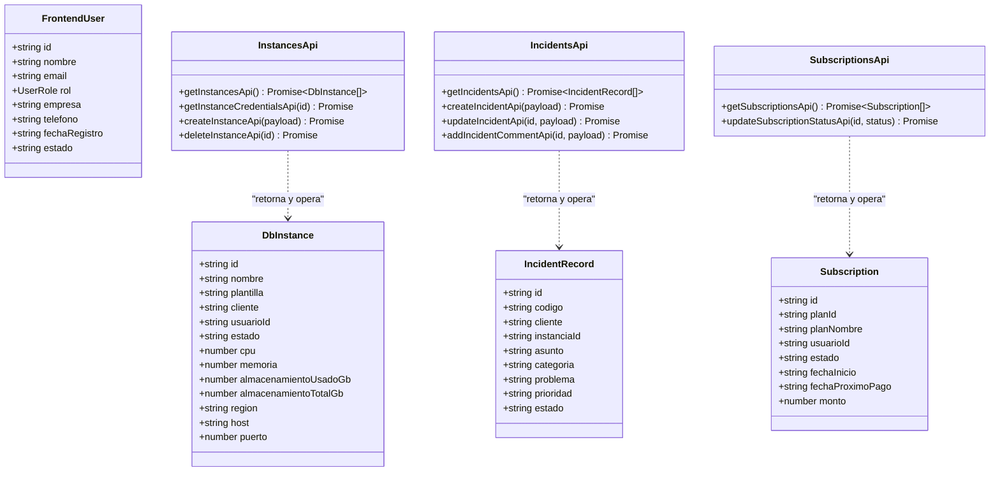

**[Imagen 7]**
> Espacio para pegar la imagen del diagrama aquí.

---

### 8. Diagrama de clases - Arquitectura de Paneles y Componentes UI (frontend - features)

**¿Para qué es?**
Estructura la vista de componentes de React 19, cómo `App.tsx` enruta a los paneles específicos según el rol (`AdminPanel`, `ClientPanel`, `SupportPanel`, `Landing`, `Login`) y su dependencia del contexto global de autenticación (`AuthContext`). Utilizado para auditorías de arquitectura frontend y diseño modular.

**Código Mermaid**
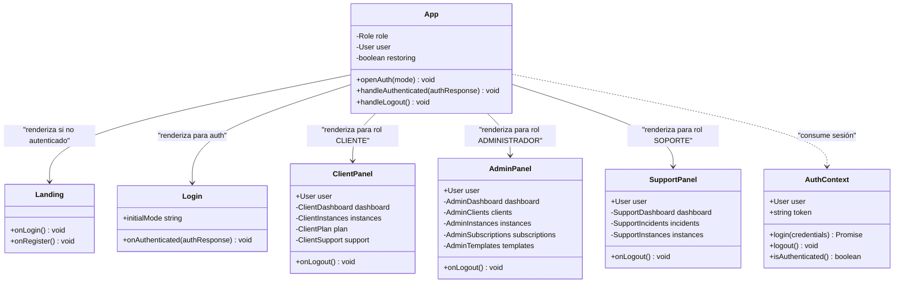

**[Imagen 8]**
> Espacio para pegar la imagen del diagrama aquí.

---

## 2. Diagramas de Actividad

### 9. Diagrama de actividad - Registro y Creación de Cuenta (Auth)

**¿Para qué es?**
Modela el flujo de negocio del registro de un nuevo cliente agrícola, desde el envío del formulario de registro, validación de correo existente, selección de plan y emisión del token JWT inicial. Utilizado por diseñadores de UX y desarrolladores de backend.

**Código Mermaid**
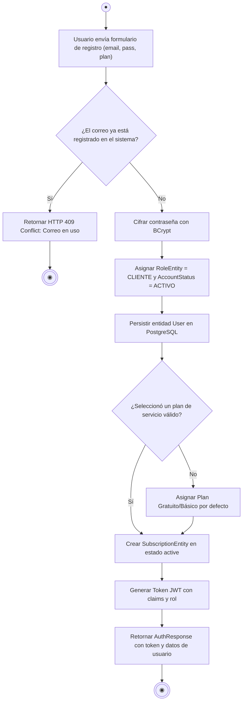

**[Imagen 9]**
> Espacio para pegar la imagen del diagrama aquí.

---

### 10. Diagrama de actividad - Aprovisionamiento de Nueva Instancia (Instance)

**¿Para qué es?**
Describe el proceso que sigue el sistema cuando un cliente solicita una nueva base de datos PostgreSQL, verificando la cuota máxima permitida por su plan, cifrando las credenciales generadas y aprovisionando de forma real el esquema PostgreSQL (`inst_<nombre>_<hash>`) con las tablas relacionales y datos iniciales de la plantilla seleccionada. Usado para validar lógica de negocio y pruebas de integración.

**Código Mermaid**
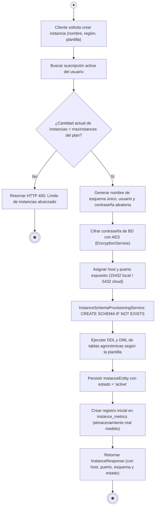

**[Imagen 10]**
> Espacio para pegar la imagen del diagrama aquí.

---

### 11. Diagrama de actividad - Gestión del Ciclo de Vida de Incidencias (Incident)

**¿Para qué es?**
Detalla las etapas y tomas de decisión desde que un cliente reporta una falla en su instancia hasta que un agente de soporte diagnostica, responde mediante comentarios y marca el ticket como resuelto. Utilizado en la capacitación del equipo de soporte y QA.

**Código Mermaid**
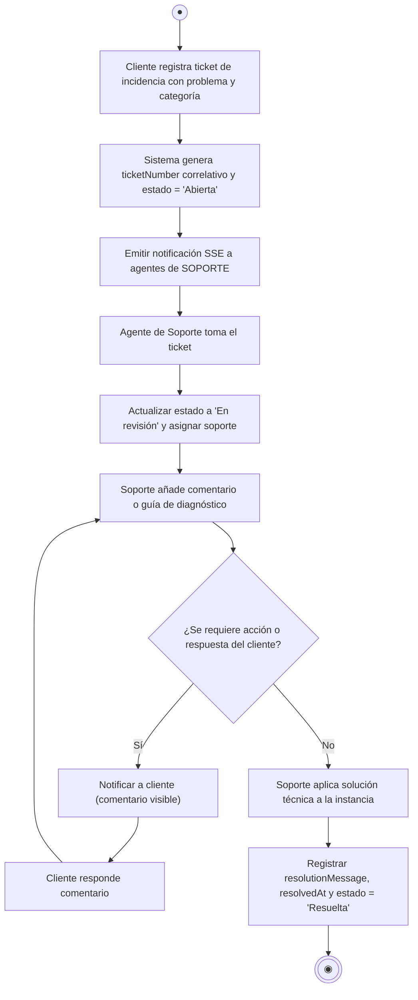

**[Imagen 11]**
> Espacio para pegar la imagen del diagrama aquí.

---

### 12. Diagrama de actividad - Procesamiento de Pago y Facturación (Payment)

**¿Para qué es?**
Representa el flujo de cobro periódico o manual de la suscripción, validando el monto, registrando la transacción bancaria/tarjeta y emitiendo la factura legal electrónica asociada. Indispensable para conciliación contable.

**Código Mermaid**
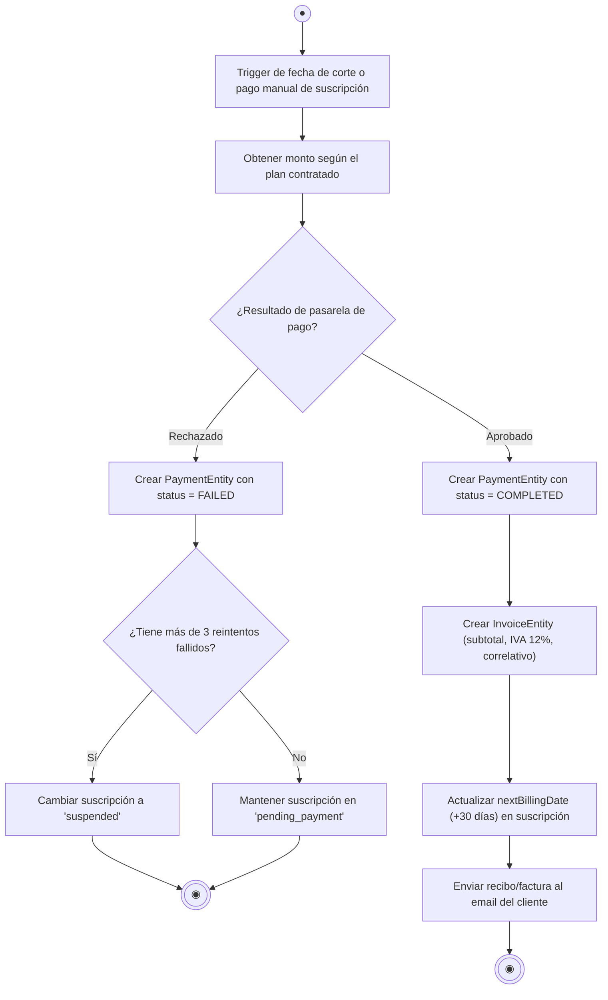

**[Imagen 12]**
> Espacio para pegar la imagen del diagrama aquí.

---

### 13. Diagrama de actividad - Administración de Usuarios y Asignación de Roles (AdminUser)

**¿Para qué es?**
Modela el proceso mediante el cual el administrador del sistema da de alta a nuevos empleados (soporte u otros administradores), modifica datos corporativos o suspende cuentas de usuarios morosos desde el panel de control (`AdminUserController`).

**Código Mermaid**
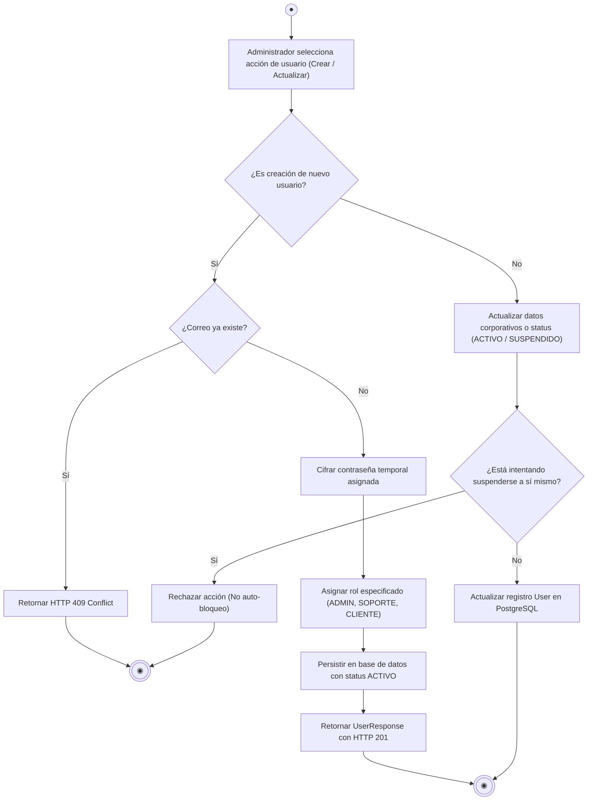

**[Imagen 13]**
> Espacio para pegar la imagen del diagrama aquí.

---

## 3. Diagramas de Casos de Uso

### 14. Diagrama de casos de uso - Visitante No Autenticado (landing / auth)

**¿Para qué es?**
Modela las interacciones que un visitante anónimo puede realizar en el sitio web antes de iniciar sesión: consultar la propuesta de valor, comparar planes agrícolas, iniciar sesión y registrarse.

**Código Mermaid**
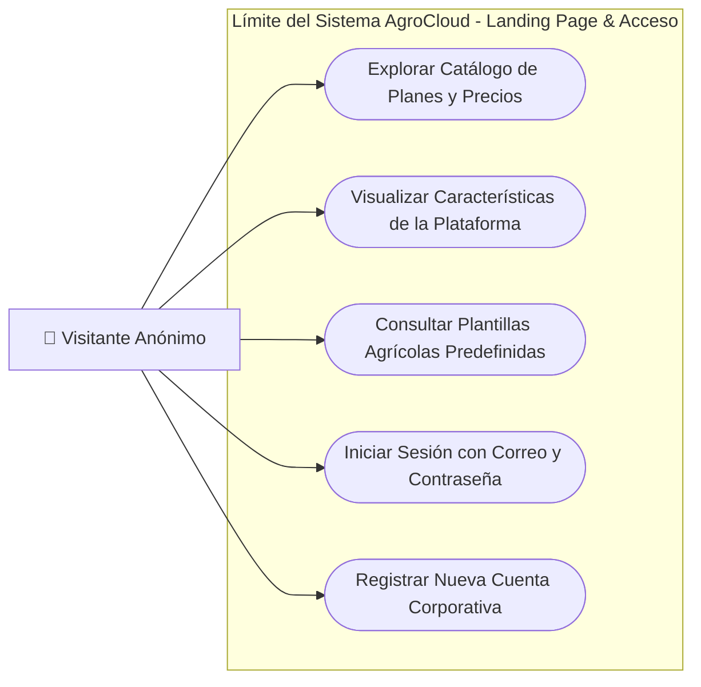

**[Imagen 14]**
> Espacio para pegar la imagen del diagrama aquí.

---

### 15. Diagrama de casos de uso - Cliente Agrícola (client)

**¿Para qué es?**
Delimita las funcionalidades disponibles para el actor con rol `CLIENTE`, quien administra sus bases de datos agrícolas, monitorea el consumo de almacenamiento y solicita asistencia técnica. Esencial para la definición del alcance funcional del frontend de clientes.

**Código Mermaid**
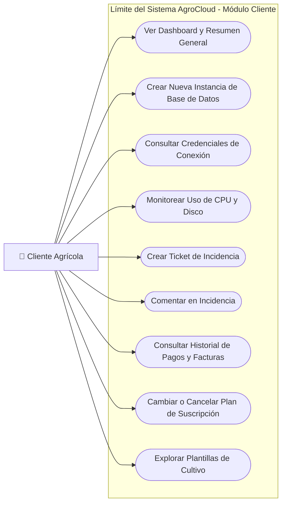

**[Imagen 15]**
> Espacio para pegar la imagen del diagrama aquí.

---

### 16. Diagrama de casos de uso - Administrador del Sistema (admin)

**¿Para qué es?**
Representa los casos de uso privilegiados del actor `ADMINISTRADOR`: supervisión global de clientes, alteración de estados de instancias, altas/bajas de plantillas agronómicas y configuración de tarifas de planes.

**Código Mermaid**
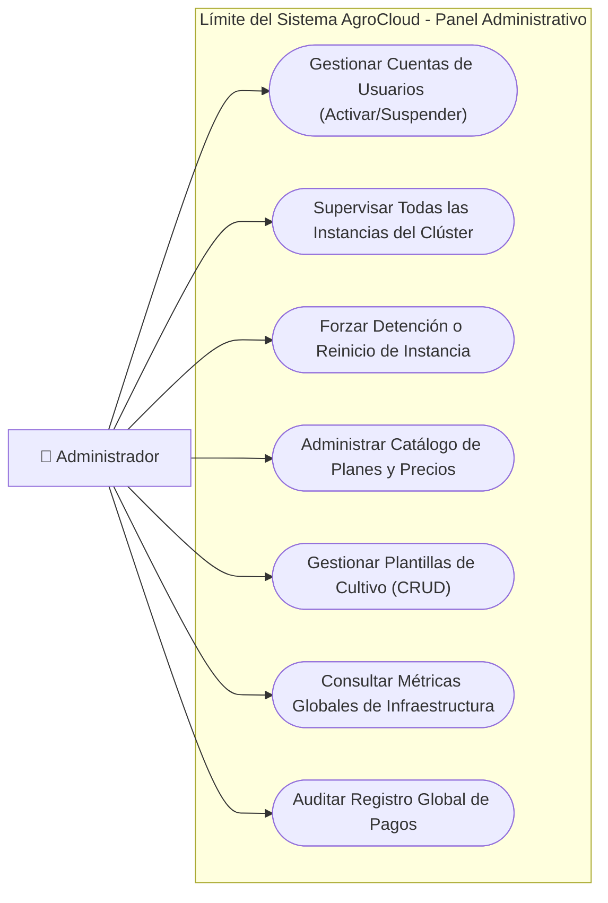

**[Imagen 16]**
> Espacio para pegar la imagen del diagrama aquí.

---

### 17. Diagrama de casos de uso - Agente de Soporte Técnico (support)

**¿Para qué es?**
Mapea las acciones operativas del personal de soporte técnico (`SOPORTE`), quienes atienden tickets, analizan diagnósticos guiados e interactúan con los clientes para restaurar servicios.

**Código Mermaid**
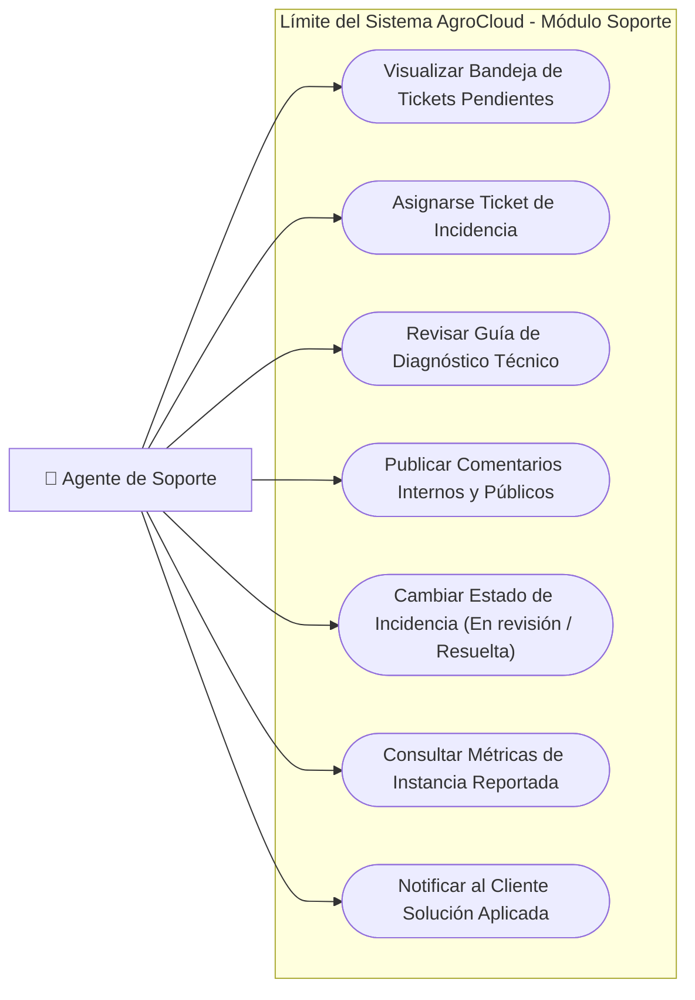

**[Imagen 17]**
> Espacio para pegar la imagen del diagrama aquí.

---

## 4. Diagramas de Secuencia

### 18. Diagrama de secuencia - Autenticación y Obtención de Token JWT (Auth)

**¿Para qué es?**
Describe el intercambio temporal de mensajes entre el navegador (Frontend), el filtro de seguridad de Spring Boot, los servicios de aplicación y la base de datos PostgreSQL durante el inicio de sesión. Permite verificar el flujo de seguridad ante auditorías técnicas.

**Código Mermaid**
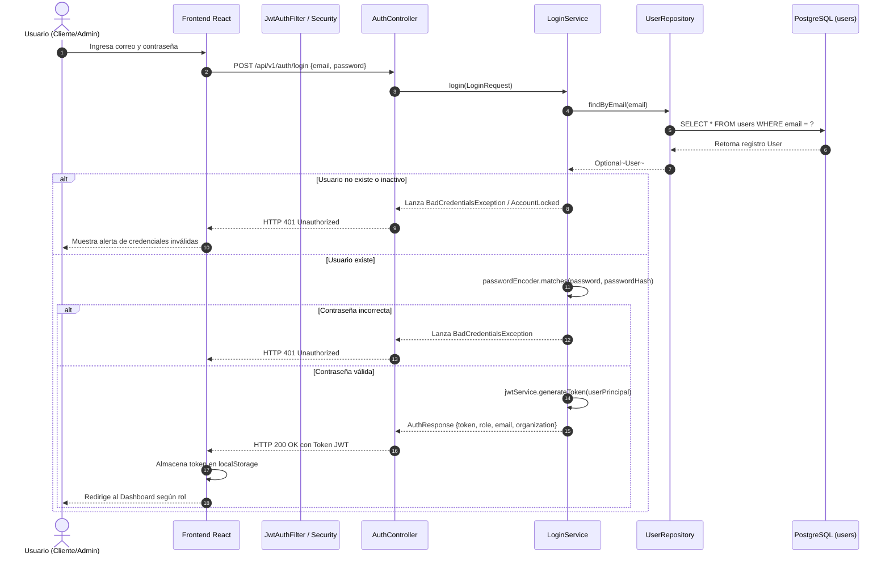

**[Imagen 18]**
> Espacio para pegar la imagen del diagrama aquí.

---

### 19. Diagrama de secuencia - Creación y Aprovisionamiento de Instancia con Clave Cifrada (Instance)

**¿Para qué es?**
Modela el proceso completo de provisión de base de datos bajo el modelo multi-tenant Schema-per-Instance: validación del plan del usuario, cifrado simétrico AES de la contraseña, aprovisionamiento real del esquema PostgreSQL con sus tablas de plantilla agronómica y registro de métricas iniciales.

**Código Mermaid**
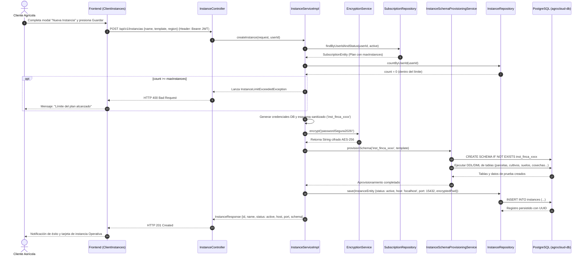

**[Imagen 19]**
> Espacio para pegar la imagen del diagrama aquí.

---

### 20. Diagrama de secuencia - Apertura e Interacción en Incidencia de Soporte (Incident)

**¿Para qué es?**
Muestra la comunicación en tiempo real cuando un cliente reporta un problema, el agente responde con comentarios técnicos y el sistema notifica vía Server-Sent Events (SSE).

**Código Mermaid**
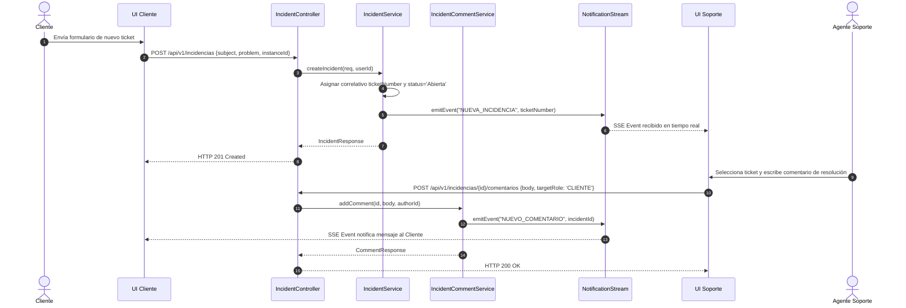

**[Imagen 20]**
> Espacio para pegar la imagen del diagrama aquí.

---

### 21. Diagrama de secuencia - Consulta de Métricas y Telemetría en Tiempo Real (Monitoring)

**¿Para qué es?**
Modela la petición de telemetría que efectúan tanto el agricultor como el administrador desde el Dashboard para visualizar el estado de salud, memoria, CPU y almacenamiento de una base de datos.

**Código Mermaid**
```mermaid
sequenceDiagram
    autonumber
    actor Usuario as Cliente o Administrador
    participant UI as Frontend (Dashboard / Monitoring)
    participant Ctrl as InstanceController
    participant Svc as InstanceServiceImpl
    participant MetricRepo as InstanceMetricRepository
    participant DB as PostgreSQL (instance_metrics)

    Usuario->>UI: Abre pestaña de Monitoreo de Instancia
    UI->>Ctrl: GET /api/v1/instancias/{id}/monitoreo (Header: Bearer JWT)
    Ctrl->>Svc: getMonitoring(instanceId)
    Svc->>MetricRepo: findTopByInstanceIdOrderByRecordedAtDesc(instanceId)
    MetricRepo->>DB: SELECT * FROM instance_metrics WHERE instance_id = ? ORDER BY recorded_at DESC LIMIT 1
    DB-->>MetricRepo: Retorna métricas más recientes
    MetricRepo-->>Svc: InstanceMetricEntity (cpu, ram, storage)
    Svc-->>Ctrl: InstanceMonitoringResponse {cpuPercentage, ramPercentage, usedStorageGb, totalStorageGb}
    Ctrl-->>UI: HTTP 200 OK con JSON de telemetría
    UI->>UI: Actualiza indicadores circulares y barras de progreso
    UI-->>Usuario: Muestra gráficos de salud en tiempo real
```

**[Imagen 21]**
> Espacio para pegar la imagen del diagrama aquí.

---

### 22. Diagrama de secuencia - Alta y Modificación Administrativa de Usuarios (AdminUsers)

**¿Para qué es?**
Representa la interacción segura mediante la cual un Administrador autenticado crea una cuenta para un agente de soporte o modifica el estado de activación de un cliente desde el panel central.

**Código Mermaid**
```mermaid
sequenceDiagram
    autonumber
    actor Admin as Administrador
    participant UI as AdminUsers / AdminClients
    participant Ctrl as AdminUserController
    participant Svc as AdminUserService
    participant Repo as UserRepository
    participant DB as PostgreSQL

    Admin->>UI: Ingresa datos en "Nuevo Usuario" (email, rol, contraseña)
    UI->>Ctrl: POST /api/v1/usuarios {email, role: 'SOPORTE', ...} (Bearer JWT)
    Ctrl->>Svc: create(AdminCreateUserRequest)
    Svc->>Repo: existsByEmail(email)
    Repo-->>Svc: false (correo libre)
    Svc->>Svc: passwordEncoder.encode(tempPassword)
    Svc->>Repo: save(User {role: SOPORTE, status: ACTIVO, ...})
    Repo->>DB: INSERT INTO users (...)
    DB-->>Repo: Registro guardado
    Svc-->>Ctrl: UserResponse {id, email, rol: 'SOPORTE', estado: 'ACTIVO'}
    Ctrl-->>UI: HTTP 201 Created
    UI-->>Admin: Muestra toast de confirmación y recarga lista de personal
```

**[Imagen 22]**
> Espacio para pegar la imagen del diagrama aquí.

---

## 5. Diagramas de Estados

### 23. Diagrama de estados - Instancia de Base de Datos (InstanceEntity)

**¿Para qué es?**
Representa las transiciones del ciclo de vida de una instancia PostgreSQL administrada (`InstanceStatus`), modelando sus estados desde la activación hasta su suspensión o terminación definitiva.

**Código Mermaid**
```mermaid
stateDiagram-v2
    [*] --> active : Aprovisionamiento exitoso

    active --> revision : Reporte de falla crítica / mantenimiento programado
    revision --> active : Reparación confirmada por soporte

    active --> suspended : Falta de pago / Violación de términos
    revision --> suspended : Inactividad prolongada sin resolución

    suspended --> active : Pago recibido / Reactivación administrativa
    suspended --> terminated : Plazo de gracia vencido (destrucción de datos)

    terminated --> [*]
```

**[Imagen 23]**
> Espacio para pegar la imagen del diagrama aquí.

---

### 24. Diagrama de estados - Suscripción de Servicio (SubscriptionEntity)

**¿Para qué es?**
Modela el ciclo de facturación y vigencia del contrato de servicio de un cliente (`SubscriptionStatus`), gobernando la disponibilidad de las cuotas de recursos.

**Código Mermaid**
```mermaid
stateDiagram-v2
    [*] --> pending_payment : Registro inicial / Selección de plan de pago

    pending_payment --> active : Transacción aprobada por pasarela
    pending_payment --> cancelled : Abandono de registro / Timeout de pago

    active --> pending_payment : Llegada de fecha de corte (nextBillingDate)
    active --> suspended : Cobro recurrente fallido reiterado
    active --> cancelled : Solicitud explícita de baja por el usuario

    suspended --> active : Pago pendiente regularizado
    suspended --> cancelled : Morosidad definitiva

    cancelled --> [*]
```

**[Imagen 24]**
> Espacio para pegar la imagen del diagrama aquí.

---

### 25. Diagrama de estados - Incidencia de Soporte (IncidentEntity)

**¿Para qué es?**
Describe los estados que atraviesa un ticket de soporte técnico desde su apertura por parte del agricultor hasta su resolución y archivo.

**Código Mermaid**
```mermaid
stateDiagram-v2
    [*] --> Abierta : Cliente reporta ticket

    Abierta --> En_revision : Agente de soporte se asigna el caso
    En_revision --> En_revision : Intercambio de comentarios y diagnóstico

    En_revision --> Resuelta : Soporte aplica solución y documenta resolución
    Resuelta --> En_revision : Cliente reporta persistencia del fallo (reapertura)
    
    Resuelta --> Cerrada : Confirmación de satisfacción / Timeout de cierre
    Cerrada --> [*]
```

**[Imagen 25]**
> Espacio para pegar la imagen del diagrama aquí.

---

### 26. Diagrama de estados - Transacción de Pago (PaymentEntity)

**¿Para qué es?**
Representa el estado transaccional de un intento de cobro en el sistema contable (`PaymentStatus`), garantizando consistencia en la generación de comprobantes.

**Código Mermaid**
```mermaid
stateDiagram-v2
    [*] --> PENDING : Intento de cobro iniciado

    PENDING --> COMPLETED : Autorización bancaria exitosa (genera factura)
    PENDING --> REJECTED : Fondos insuficientes / Datos inválidos
    PENDING --> FAILED : Error de conexión con pasarela / Timeout

    FAILED --> PENDING : Reintento automático programado
    REJECTED --> [*]
    COMPLETED --> [*]
```

**[Imagen 26]**
> Espacio para pegar la imagen del diagrama aquí.

---

## 6. Diagrama de Componentes

### 27. Diagrama de componentes - Arquitectura Global del Sistema (Architecture)

**¿Para qué es?**
Presenta la arquitectura física y lógica en capas de AgroCloud: Single Page Application (SPA), controladores REST, servicios desacoplados por dominio, persistencia Spring Data JPA y motor relacional PostgreSQL. Es la vista maestra para arquitectos de software y sustentaciones.

**Código Mermaid**
```mermaid
flowchart TD
    subgraph FrontendApp ["Capa de Presentación (Frontend SPA - React / Vite)"]
        UI_Router["React Router & Layouts"]
        UI_AuthContext["AuthContext & Interceptores Axios"]
        UI_Features["Módulos UI (Client / Admin / Support)"]
        UI_API["Clientes API Tipados (instancesApi, etc.)"]
    end

    subgraph BackendApp ["Capa de Aplicación (Backend - Spring Boot 3 / Java 17)"]
        subgraph SecurityLayer ["Seguridad"]
            Sec_Filter["JwtAuthenticationFilter"]
            Sec_Config["SecurityConfig & CORS"]
        end

        subgraph RESTControllers ["Controladores REST"]
            Ctrl_Auth["AuthController"]
            Ctrl_User["AdminUserController"]
            Ctrl_Inst["InstanceController"]
            Ctrl_Sub["SubscriptionController"]
            Ctrl_Inc["IncidentController"]
            Ctrl_Pay["PaymentController & InvoiceController"]
            Ctrl_Tpl["TemplateController"]
        end

        subgraph DomainServices ["Servicios de Dominio"]
            Svc_User["AdminUserService & RegistrationService"]
            Svc_Inst["InstanceService"]
            Svc_Prov["InstanceSchemaProvisioningService\n(DDL/DML multi-tenant)"]
            Svc_Sub["SubscriptionService"]
            Svc_Inc["IncidentService & CommentService"]
            Svc_Pay["PaymentService & InvoiceService"]
            Svc_Enc["EncryptionService (AES)"]
            Svc_Notif["NotificationStream (SSE)"]
        end

        subgraph Repositories ["Acceso a Datos (Spring Data JPA)"]
            Repo_User["UserRepository"]
            Repo_Inst["InstanceRepository & MetricRepo"]
            Repo_Sub["SubscriptionRepository"]
            Repo_Inc["IncidentRepository"]
            Repo_Pay["PaymentRepository & InvoiceRepo"]
        end
    end

    subgraph DatabaseLayer ["Capa de Datos"]
        DB[(PostgreSQL 16 Engine\nagrocloud_db)]
        DBSchemas[(Esquemas Multi-Tenant\ninst_nombre_hash)]
    end

    UI_Features --> UI_API
    UI_API -->|HTTPS / JSON + Bearer JWT| Sec_Filter
    Sec_Filter --> RESTControllers
    RESTControllers --> DomainServices
    DomainServices --> Repositories
    Svc_Inst --> Svc_Prov
    Svc_Inst -.-> Svc_Enc
    DomainServices -.-> Svc_Notif
    Repositories -->|JDBC HikariCP Pool| DB
    Svc_Prov -->|JdbcTemplate DDL/DML| DBSchemas
```

**[Imagen 27]**
> Espacio para pegar la imagen del diagrama aquí.

---

## 7. Diagrama de Despliegue

### 28. Diagrama de despliegue - Infraestructura de Producción y Contenedores (Deployment)

**¿Para qué es?**
Ilustra el entorno de ejecución real de AgroCloud, detallando los nodos, puertos de red, volúmenes de almacenamiento persistente y contenedores Docker orquestados con Docker Compose según el archivo `docker-compose.yml`.

**Código Mermaid**
```mermaid
flowchart TD
    subgraph ClientDevice ["Dispositivos de Usuario & Clientes Externos"]
        Browser["Navegador Web AgroCloud (Chrome / Firefox)"]
        ExternalApp["Aplicación Externa Cliente (React / Node / DBeaver)"]
    end

    subgraph CloudHost ["Servidor Host de Despliegue (Docker Desktop / Compose)"]
        Host_8080["Puerto Host: 8080 (HTTP API)"]
        Host_15432["Puerto Host: 15432 (PostgreSQL TCP)"]

        subgraph Net_Bridge ["Red Interna: agrocloud (Bridge)"]
            
            subgraph Container_API ["Contenedor: agrocloud-api (Spring Boot 3)"]
                JVM["Eclipse Temurin OpenJDK 17 (JVM)"]
                AppJar["app.jar (Spring Boot Executable)"]
                Port_8080["Puerto Interno: 8080"]
            end

            subgraph Container_DB ["Contenedor: agrocloud-db (PostgreSQL 16)"]
                PgEngine["Motor PostgreSQL 16 (Multi-Tenant)"]
                Port_5432["Puerto Interno: 5432"]
                CoreSchema["Esquema Principal: public (Tablas AgroCloud)"]
                TenantSchemas["Esquemas Clientes: inst_nombre_hash (DBaaS)"]
            end
        end

        subgraph HostStorage ["Almacenamiento Persistente en Host"]
            Vol_PG[("Volumen Docker: postgres_data")]
            Bind_Artifacts["Bind Mount: ./build-artifacts/app.jar"]
        end
    end

    Browser -->|HTTP REST / SSE :8080| Host_8080
    Host_8080 --> Port_8080
    Port_8080 --> JVM
    JVM --> AppJar
    AppJar -->|JDBC HikariCP :5432| Port_5432
    Port_5432 --> PgEngine
    PgEngine --> CoreSchema
    PgEngine --> TenantSchemas
    PgEngine --> Vol_PG
    Bind_Artifacts -.->|Montado como Read-Only| AppJar

    ExternalApp -->|JDBC / PG TCP :15432| Host_15432
    Host_15432 --> Port_5432
```

**[Imagen 28]**
> Espacio para pegar la imagen del diagrama aquí.

---

## 8. Diagrama de Paquetes

### 29. Diagrama de paquetes - Estructura Modular Backend Spring Boot (Packages)

**¿Para qué es?**
Muestra la organización física de paquetes en Java bajo `com.agrocloud.backend` y sus dependencias mutuas, evidenciando el diseño guiado por dominios y la ausencia de dependencias circulares.

**Código Mermaid**
```mermaid
flowchart TD
    subgraph com.agrocloud.backend ["com.agrocloud.backend"]
        pkg_security["security\n(JWT, Filters, UserPrincipal, AES)"]
        pkg_entity["entity\n(User, RoleEntity, Enums)"]
        pkg_instance["instance\n(controller, service, repository, entity)"]
        pkg_subscription["subscription\n(controller, service, repository, entity)"]
        pkg_plan["plan\n(controller, service, repository, entity)"]
        pkg_payment["payment\n(controller, service, repository, entity)"]
        pkg_incident["incident\n(controller, service, repository, entity)"]
        pkg_template["template\n(controller, service, repository, entity)"]
        pkg_notification["notification\n(controller, service, SSE stream)"]
    end

    pkg_security --> pkg_entity
    pkg_instance --> pkg_entity
    pkg_instance --> pkg_plan
    pkg_instance --> pkg_security
    pkg_subscription --> pkg_entity
    pkg_subscription --> pkg_plan
    pkg_payment --> pkg_subscription
    pkg_incident --> pkg_entity
    pkg_incident --> pkg_instance
    pkg_incident --> pkg_notification
```

**[Imagen 29]**
> Espacio para pegar la imagen del diagrama aquí.

---

## 9. Diagrama Entidad-Relación

### 30. Diagrama entidad-relación - Base de Datos Relacional PostgreSQL (ERD)

**¿Para qué es?**
Especifica el modelo físico de la base de datos relacional de AgroCloud, detallando claves primarias (PK), foráneas (FK), tipos de datos y cardinalidades exactas según los esquemas JPA de las entidades.

**Código Mermaid**
```mermaid
erDiagram
    users {
        uuid id PK
        varchar organization_name
        varchar contact_name
        varchar email UK
        varchar phone
        varchar password_hash
        varchar role_code FK
        varchar status
        timestamptz created_at
        timestamptz updated_at
    }

    roles {
        varchar name PK
    }

    service_plans {
        varchar id PK
        varchar name
        float8 storage_gb
        numeric monthly_price
        text description
        int4 max_instances
        bool is_popular
        bool is_active
    }

    subscriptions {
        uuid id PK
        uuid user_id FK
        varchar plan_id FK
        varchar status
        date start_date
        date next_billing_date
        numeric amount
        timestamptz created_at
        timestamptz updated_at
    }

    instances {
        uuid id PK
        varchar name
        varchar template
        varchar version
        varchar status
        varchar region
        varchar host
        int4 port
        varchar db_name
        varchar db_user
        varchar db_password_encrypted
        uuid user_id FK
        varchar plan_id FK
        timestamptz created_at
        timestamptz updated_at
    }

    instance_metrics {
        uuid id PK
        uuid instance_id FK
        float8 used_storage_gb
        float8 total_storage_gb
        float8 cpu_usage_percentage
        float8 memory_usage_percentage
        varchar status
        timestamptz recorded_at
    }

    payments {
        uuid id PK
        uuid subscription_id FK
        numeric amount
        timestamptz payment_date
        varchar status
        varchar reference
        varchar payment_method
        varchar concept
        timestamptz created_at
        timestamptz updated_at
    }

    invoices {
        uuid id PK
        uuid payment_id FK
        varchar invoice_number UK
        timestamptz issue_date
        numeric subtotal
        numeric tax
        numeric total
        varchar customer_name
        varchar customer_email
        varchar concept
        timestamptz created_at
    }

    incidents {
        uuid id PK
        int8 ticket_number UK
        uuid owner_id FK
        uuid instance_id FK
        uuid assigned_support_id FK
        varchar subject
        varchar category
        text problem
        varchar priority
        varchar status
        text diagnostic_guide
        varchar resolution_message
        uuid resolved_by_id FK
        timestamptz resolved_at
        timestamptz created_at
        timestamptz updated_at
    }

    incident_comments {
        uuid id PK
        uuid incident_id FK
        uuid author_id FK
        varchar body
        varchar target_role
        timestamptz created_at
    }

    agrocloud_plantillas {
        varchar id PK
        varchar nombre
        varchar descripcion
        int4 tablas
        varchar version
        int4 instancias
        varchar estado
        varchar schema_tables
        timestamp created_at
        timestamp updated_at
    }

    notifications {
        uuid id PK
        uuid recipient_id FK
        varchar type
        varchar title
        text message
        uuid resource_id
        timestamptz read_at
        timestamptz created_at
    }

    roles ||--o{ users : "role_code"
    users ||--o{ subscriptions : "user_id"
    service_plans ||--o{ subscriptions : "plan_id"
    users ||--o{ instances : "user_id"
    service_plans ||--o{ instances : "plan_id"
    instances ||--o{ instance_metrics : "instance_id"
    subscriptions ||--o{ payments : "subscription_id"
    payments ||--|| invoices : "payment_id"
    users ||--o{ incidents : "owner_id"
    instances ||--o{ incidents : "instance_id"
    users ||--o{ incidents : "assigned_support_id"
    incidents ||--o{ incident_comments : "incident_id"
    users ||--o{ incident_comments : "author_id"
    users ||--o{ notifications : "recipient_id"
```

**[Imagen 30]**
> Espacio para pegar la imagen del diagrama aquí.

---

## Notas

1. **Esquema de Plantillas Agronómicas:** La entidad [`TemplateEntity`](file:///c:/Users/ovall/OneDrive%20-%20Universidad%20Rafael%20Landivar/Escritorio/AgroCloud/backend/src/main/java/com/agrocloud/backend/template/entity/TemplateEntity.java) utiliza nombres de campo en español (`nombre`, `descripcion`, `tablas`, `schemaTables`) y mapea a la tabla `agrocloud_plantillas`. Esto se preservó fielmente en los diagramas de clases y ERD sin forzar nombres hipotéticos en inglés.
2. **Motor de Aprovisionamiento Real (Schema-per-Instance):** La creación de instancias en [`InstanceServiceImpl`](file:///c:/Users/ovall/OneDrive%20-%20Universidad%20Rafael%20Landivar/Escritorio/AgroCloud/backend/src/main/java/com/agrocloud/backend/instance/service/InstanceServiceImpl.java) utiliza [`InstanceSchemaProvisioningService`](file:///c:/Users/ovall/OneDrive%20-%20Universidad%20Rafael%20Landivar/Escritorio/AgroCloud/backend/src/main/java/com/agrocloud/backend/instance/service/InstanceSchemaProvisioningService.java) para ejecutar de forma real sentencias SQL `CREATE SCHEMA IF NOT EXISTS` y correr el DDL y DML de las plantillas agronómicas (ej. "Cultivos y parcelas", "Ganadería y pastos", etc.). Los clientes pueden conectarse directamente desde aplicaciones externas a través del puerto mapeado `15432` en local o `5432` en nube, aislando completamente sus datos en su propio esquema.
3. **Cifrado de Credenciales:** La contraseña generada aleatoriamente para cada base de datos se cifra simétricamente con AES-256 en [`EncryptionService`](file:///c:/Users/ovall/OneDrive%20-%20Universidad%20Rafael%20Landivar/Escritorio/AgroCloud/backend/src/main/java/com/agrocloud/backend/security/EncryptionService.java), persistiendo únicamente el hash en la columna `db_password_encrypted` y desencriptándola únicamente bajo petición autorizada del propietario (`/api/v1/instancias/{id}/credenciales`).
4. **Flujo de Pago y Facturación:** Los pagos en [`PaymentEntity`](file:///c:/Users/ovall/OneDrive%20-%20Universidad%20Rafael%20Landivar/Escritorio/AgroCloud/backend/src/main/java/com/agrocloud/backend/payment/entity/PaymentEntity.java) registran transacciones locales que permiten asociar facturas (`InvoiceEntity`) de inmediato mediante correlativos internos generados automáticamente.
5. **Validación de Sintaxis:** Todos los bloques Mermaid (`classDiagram`, `flowchart`, `sequenceDiagram`, `stateDiagram-v2`, `erDiagram`) han sido configurados con identificadores alfanuméricos sin caracteres especiales para garantizar renderizado inmediato en GitHub y en [mermaid.live](https://mermaid.live).
